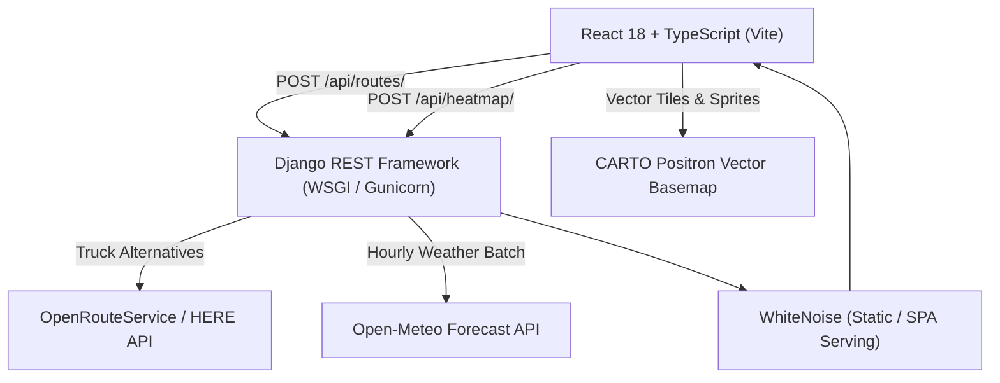

# 🚛 RouteWise — Weather-Aware Truck Routing Intelligence

A full-stack, enterprise-grade SaaS intelligence platform for calculating, scoring, and visualizing weather-safe commercial truck routes across North America. Built with **React 18, TypeScript, MapLibre GL JS, deck.gl, Django REST Framework, OpenRouteService (driving-hgv), and Open-Meteo**.

---

## 🌟 Key Features

1. **3 Alternative Commercial Truck Routes**:
   - Fetches heavy goods vehicle routes using **OpenRouteService Directions v2** (`driving-hgv` profile with `alternative_routes`).
   - Supports GeoJSON coordinate decoding with transit duration, distance, and leg geometry.
   - Built-in geographic fallback generator if API limits are reached or external services are unavailable.

2. **3-Column SaaS Operational Workspace**:
   - **Top Navigation Bar**: Live telemetry, route metrics, connection status indicator, and quick-access freight presets (`Chicago → Dallas`, `Denver → Salt Lake`, `Atlanta → Miami`).
   - **Left Sidebar (Route Planner & Selection)**:
     - Searchable, scrollable city comboboxes for North American freight hubs with instant swapping.
     - Stacked Departure date/time and Load Weight (lbs) inputs with live validation.
     - Checkpoint sampling interval selector (**10 mi, 25 mi, 50 mi**).
     - Route cards with safety ranks, "✦ Best Route" recommendation badge, and risk mileage breakdown bars.
   - **Center Map Canvas**:
     - High-performance MapLibre GL engine with **CARTO Positron** vector basemap tiles.
     - deck.gl `PathLayer` for color-coded risk corridors and `ScatterplotLayer` for interactive checkpoint waypoints.
     - Interactive weather inspection tooltips displaying wind speed, gusts, precipitation rates, and temperatures.
     - Floating 0–48 hour forecast time slider for real-time weather scrubbing.
   - **Right Sidebar (Route Dossier)**:
     - Deep operational breakdown for the selected route: safety badge, critical hazard alerts, route telemetry overview, and scrollable checkpoint-by-checkpoint timeline.

3. **Hyper-Local Forecast Forecasting (Open-Meteo API)**:
   - Batch-fetches 0–48 hour hourly forecasts from Open-Meteo with zero API key requirement.
   - Matches checkpoint ETAs with forecast timestamps to evaluate real conditions at the exact moment a truck passes each waypoint.

4. **Exact Risk Classification & Load Sensitivity**:
   - Categorizes conditions into 5 strict safety tiers: `Low`, `Moderate`, `High`, `Severe`, and `No Travel`.
   - **Dynamic Load Sensitivity**: Crosswind safety thresholds scale downward for lighter trailers (< 40,000 lbs) to account for high-profile rollover hazards.
   - Evaluates sustained winds, wind gusts, rain intensity, snowfall rates, and frozen precipitation codes.

5. **Lexicographic Route Recommendation Engine**:
   - Ranks routes based on safety-first criteria:
     1. Fewest Severe miles (including No-Travel conditions)
     2. Fewest High-risk miles
     3. Lowest average composite risk score
     4. Shortest travel duration
   - Automatically selects and highlights the **#1 Recommended Route** with a prominent badge.

6. **CARTO Basemap Authentication**:
   - Native support for `CARTO_BASE_URL` and `CARTO_API_TOKEN` configured in `frontend/.env.local`.
   - Automatic request signing and Authorization header injection via `cartoTransformRequest` for crisp, vector-rendered tiles.

---

## 🏗 System Architecture



---

## 📁 Repository Structure

```
WeatherAwareRouting/
├── backend/
│   ├── config/               # Django project settings, WSGI, unified SPA URLs
│   │   ├── settings.py
│   │   ├── urls.py
│   │   └── wsgi.py
│   ├── routing/              # Core routing & weather engine
│   │   ├── services/
│   │   │   ├── here.py       # Routing service client + polyline decoder
│   │   │   ├── checkpoints.py# Spatial interpolation at 10/25/50 mi
│   │   │   ├── weather.py    # Open-Meteo batch forecast client
│   │   │   ├── risk.py       # Risk classification matrix + load rules
│   │   │   ├── ranking.py    # Lexicographic recommendation engine
│   │   │   └── heatmap.py    # Bounding box grid generator + frame builder
│   │   ├── tests/            # 108 unit tests (100% passing)
│   │   ├── serializers.py    # Request & response validation
│   │   ├── views.py          # RouteView, HeatmapView
│   │   └── urls.py
│   ├── requirements.txt
│   └── manage.py
├── frontend/
│   ├── public/
│   │   └── favicon.svg       # RouteWise SVG vector favicon
│   ├── src/
│   │   ├── components/
│   │   │   ├── SearchableCitySelect/   # Searchable freight hub combobox
│   │   │   ├── InputPanel/             # Left sidebar route planner form
│   │   │   ├── RouteSummaryPanel/      # Route cards & risk mileage bars
│   │   │   ├── SelectedRouteDossier/   # Right sidebar route dossier & telemetry
│   │   │   ├── MapCanvas/              # MapLibre + deck.gl Path, Scatter & Heatmap
│   │   │   ├── ForecastSlider/         # 0–48 hr time-scrubber with ticks
│   │   │   └── CheckpointTooltip/      # Weather popup on checkpoint hover
│   │   ├── config/
│   │   │   └── carto.ts                # CARTO API credentials & style loader
│   │   ├── context/AppContext.tsx      # Centralized state management
│   │   ├── api/routingApi.ts           # Typed API client
│   │   ├── utils/riskColors.ts         # Risk colors (RGBA tuples & Hex)
│   │   ├── utils/formatters.ts         # Formatting utilities (distance, time, wind)
│   │   └── index.css                   # Premium light theme design system
│   ├── package.json
│   ├── vite.config.ts
│   └── tsconfig.json
└── README.md
```

---

## ⚡ Quickstart Guide

### 1. Prerequisites

- **Python**: 3.10+
- **Node.js**: 18+ (npm 9+)

---

### 2. Backend Setup

```bash
cd backend

# Create and activate virtual environment
python3 -m venv venv
source venv/bin/activate  # On Windows: venv\Scripts\activate

# Install dependencies
pip install -r requirements.txt

# Set up environment variables
cp .env.example .env

# Apply migrations
python manage.py migrate

# Run tests to verify setup
pytest -v
```

---

### 3. Frontend Setup & Configuration

```bash
cd ../frontend

# Install dependencies
npm install

# (Optional) Add CARTO credentials in frontend/.env.local
# CARTO_BASE_URL=https://gcp-us-east1.api.carto.com
# CARTO_API_TOKEN=your_token_here

# Run frontend test suite
npm test

# Build production bundle
npm run build
```

---

### 4. Running Locally in Development Mode

Run backend and frontend in two separate terminals:

**Terminal 1 (Backend — Port 8000):**

```bash
cd backend
source venv/bin/activate
python manage.py runserver 8000
```

**Terminal 2 (Frontend — Port 5173 with API Proxy):**

```bash
cd frontend
npm run dev
```

Open your browser at **`http://localhost:5173`**.

---

### 5. Unified Production Deployment (Single Port)

The backend is configured with **WhiteNoise** to serve both the DRF API and the compiled React SPA from a single port (ideal for Docker, Railway, Render, or VPS deployment):

```bash
# 1. Build the frontend
cd frontend
npm run build

# 2. Collect static assets in Django
cd ../backend
source venv/bin/activate
python manage.py collectstatic --noinput

# 3. Launch with Gunicorn
gunicorn config.wsgi:application --bind 0.0.0.0:8000 --workers 3
```

Now open **`http://localhost:8000`** — the full app runs from the unified server.

---

## 🧪 Test Suites

### Backend Unit Tests (Pytest)

```bash
cd backend
pytest -v
```

- **108 tests passing** covering:
  - Coordinate interpolation and haversine calculations (`test_checkpoints.py`)
  - External routing API fallbacks and polyline decoder (`test_here.py`)
  - Weather forecast parser and batch coordinator (`test_weather.py`)
  - Exact risk classification matrix & weight adjustments (`test_risk.py`)
  - Lexicographic route ranking order (`test_ranking.py`)
  - Heatmap grid sampler and intensity clamp (`test_heatmap.py`)
  - DRF API views and HTTP status codes (`test_views.py`)

### Frontend Unit Tests (Vitest + React Testing Library)

```bash
cd frontend
npm test
```

- **40 tests passing** across 4 test suites:
  - `riskColors.test.ts`: RGBA conversions, CSS hex values, fallbacks
  - `ForecastSlider.test.tsx`: 0–48h scrubbing, step bounds, tick rendering
  - `InputPanel.test.tsx`: Validation rules, error triggers, interval buttons, swap functionality
  - `RouteSummaryPanel.test.tsx`: Card metrics, badges, risk bars, selection

---

## 📋 Weather Risk Matrix Reference

| Condition                            | Low (0)     | Moderate (1)  | High (2)      | Severe (3)                     | No Travel (4) |
| ------------------------------------ | ----------- | ------------- | ------------- | ------------------------------ | ------------- |
| **Sustained Wind (Loaded ≥40k lbs)** | < 25 mph    | 25–35 mph     | 35–45 mph     | 45–60 mph                      | > 60 mph      |
| **Sustained Wind (Light <40k lbs)**  | < 20 mph    | 20–30 mph     | 30–40 mph     | 40–50 mph                      | > 50 mph      |
| **Wind Gusts**                       | < 35 mph    | 35–45 mph     | 45–55 mph     | 55–70 mph                      | > 70 mph      |
| **Rain Rate**                        | < 0.1 in/hr | 0.1–0.3 in/hr | 0.3–0.6 in/hr | 0.6–1.0 in/hr                  | > 1.0 in/hr   |
| **Snow Rate**                        | 0 in/hr     | < 0.5 in/hr   | 0.5–1.0 in/hr | 1.0–2.0 in/hr                  | > 2.0 in/hr   |
| **Severe Conditions**                | —           | —             | Freezing Rain | Blizzard / Tornado / Hurricane |

---
