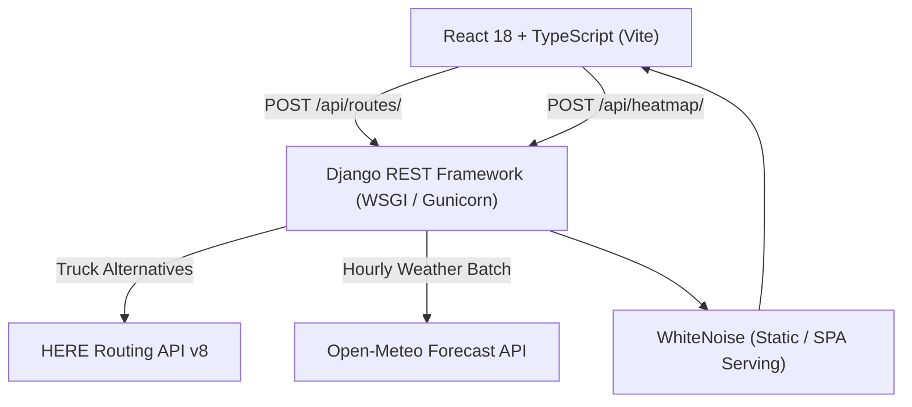

# 🚛 WeatherRoute — Weather-Aware Truck Routing Application

A full-stack, production-grade application for calculating, scoring, and visualizing weather-safe truck routes across North America. Built with **React 18, TypeScript, MapLibre GL JS, deck.gl, Django REST Framework, OpenRouteService (driving-hgv), and Open-Meteo**.

---

## 🌟 Key Features

1. **3 Alternative Truck Routes (OpenRouteService)**:
   - Fetches commercial truck routes using **OpenRouteService Directions v2** (`driving-hgv` profile with `alternative_routes`).
   - Supports GeoJSON coordinate decoding with elevation and transit duration.
   - Built-in geographic fallback generator if API key is not configured or external service limits are reached.

2. **Configurable Checkpoint Weather Sampling**:
   - Interpolates checkpoints along each route at user-configurable intervals (**10, 25, or 50 miles**).
   - Accurately computes checkpoint ETA based on departure time, leg speeds, and cumulative travel distance.

3. **Hyper-Local Forecast Forecasting (Open-Meteo API)**:
   - Batch-fetches 0–48 hour hourly forecasts from Open-Meteo with no API key requirement.
   - Matches checkpoint ETA with forecast timestamps to evaluate real conditions at the exact moment a truck passes each point.

4. **Exact Risk Classification & Load Sensitivity**:
   - Categorizes conditions into 5 strict safety levels: `Low`, `Moderate`, `High`, `Severe`, and `No Travel`.
   - Dynamic load sensitivity: crosswind safety thresholds scale downward for lighter trailers (< 40,000 lbs) to account for high-profile rollover risk.
   - Evaluates sustained winds, wind gusts, rain intensity, snowfall rates, and frozen precipitation codes.

5. **Lexicographic Route Recommendation Engine**:
   - Ranks routes based on safety-first criteria:
     1. Fewest Severe miles (including No-Travel conditions)
     2. Fewest High-risk miles
     3. Lowest average composite risk score
     4. Shortest travel duration
   - Automatically selects and highlights the **#1 Recommended Route** with a "✦ Best" badge.

6. **Interactive 2.5D/3D Map & deck.gl Overlays**:
   - Custom dark Carto raster tiles for high-contrast viewing.
   - `PathLayer`: Displays route corridors color-coded by the worst risk level on each route.
   - `ScatterplotLayer`: Renders risk-colored checkpoint dots with hover inspection tooltips displaying wind, rain, snow, temperature, and timestamp.
   - Route selection: Clicking any route card or line highlights it on map and brings it to the top.

7. **Weather Heatmap with 0–48 Hour Forecast Slider**:
   - `HeatmapLayer` (`@deck.gl/aggregation-layers`): Samples the route bounding box grid.
   - 0–48 hour forecast time slider: Scrubbing time instantly shifts the active weather heatmap frame with **zero network re-fetching**.

---

## 🏗 System Architecture



---

## 📁 Repository Structure

```
WeatherAwareRouting/
├── backend/
│   ├── config/               # Django project settings, WSGI, unified SPA URLs
│   │   ├── settings.py
│   │   ├── urls.py
│   │   └── wsgi.py
│   ├── routing/              # Core routing & weather engine
│   │   ├── services/
│   │   │   ├── here.py       # HERE Routing client + flexpolyline decoder
│   │   │   ├── checkpoints.py# Route spatial interpolation at 10/25/50 mi
│   │   │   ├── weather.py    # Open-Meteo batch forecast client
│   │   │   ├── risk.py       # Risk classification matrix + load rules
│   │   │   ├── ranking.py    # Lexicographic recommendation engine
│   │   │   └── heatmap.py    # Bounding box grid generator + frame builder
│   │   ├── tests/            # 108 unit tests (100% passing)
│   │   ├── serializers.py    # Request & response validation
│   │   ├── views.py          # RouteView, HeatmapView
│   │   └── urls.py
│   ├── requirements.txt
│   └── manage.py
├── frontend/
│   ├── src/
│   │   ├── components/
│   │   │   ├── InputPanel/         # Form inputs + Quick Preset routes
│   │   │   ├── MapCanvas/          # MapLibre + deck.gl Path, Scatter & Heatmap layers
│   │   │   ├── RouteSummaryPanel/  # Route cards, risk mileage bars, ranks
│   │   │   ├── ForecastSlider/     # 0–48 hr time-scrubber with ticks
│   │   │   └── CheckpointTooltip/  # Weather popup on checkpoint hover
│   │   ├── context/AppContext.tsx  # Centralized immutable state management
│   │   ├── api/routingApi.ts       # Typed API client
│   │   ├── utils/riskColors.ts     # Risk colors (RGBA tuples & Hex)
│   │   └── index.css               # Vanilla CSS design system & responsive layout
│   ├── package.json
│   ├── vite.config.ts
│   └── tsconfig.json
└── README.md
```

---

## ⚡ Quickstart Guide

### 1. Prerequisites
- **Python**: 3.10+
- **Node.js**: 18+ (npm 9+)

---

### 2. Backend Setup

```bash
cd backend

# Create and activate virtual environment
python3 -m venv venv
source venv/bin/activate  # On Windows: venv\Scripts\activate

# Install dependencies
pip install -r requirements.txt

# Set up environment variables
cp .env.example .env
# Edit .env and paste your OpenRouteService API key:
# ORS_API_KEY=your_actual_key_here

# Apply migrations
python manage.py migrate

# Run tests to verify setup
pytest -v
```

---

### 3. Frontend Setup

```bash
cd ../frontend

# Install dependencies
npm install

# Run frontend tests
npm test

# Build production bundle
npm run build
```

---

### 4. Running Locally in Development Mode

Run backend and frontend in two separate terminals:

**Terminal 1 (Backend - Port 8000):**
```bash
cd backend
source venv/bin/activate
python manage.py runserver 8000
```

**Terminal 2 (Frontend - Port 5173 with API Proxy):**
```bash
cd frontend
npm run dev
```

Open your browser at **`http://localhost:5173`**.

---

### 5. Unified Production Deployment (Single Port)

The backend is configured with **WhiteNoise** to serve both the DRF API and the compiled React SPA from a single port (ideal for Docker, Railway, Render, or VPS deployment):

```bash
# 1. Build the frontend
cd frontend
npm run build

# 2. Collect static assets in Django
cd ../backend
source venv/bin/activate
python manage.py collectstatic --noinput

# 3. Launch with Gunicorn
gunicorn config.wsgi:application --bind 0.0.0.0:8000 --workers 3
```

Now open **`http://localhost:8000`** — the full app runs from the unified server.

---

## 🧪 Test Suites

### Backend Unit Tests (Pytest)
```bash
cd backend
./venv/bin/pytest -v
```
- **108 tests passing** covering:
  - Coordinate interpolation and haversine calculations (`test_checkpoints.py`)
  - External routing API fallbacks and polyline decoder (`test_here.py`)
  - Weather forecast parser and batch coordinator (`test_weather.py`)
  - Exact risk classification matrix & weight adjustments (`test_risk.py`)
  - Lexicographic route ranking order (`test_ranking.py`)
  - Heatmap grid sampler and intensity clamp (`test_heatmap.py`)
  - DRF API views and HTTP status codes (`test_views.py`)

### Frontend Unit Tests (Vitest + React Testing Library)
```bash
cd frontend
npm test
```
- **40 tests passing** across 4 test suites:
  - `riskColors.test.ts`: RGBA conversions, CSS hex values, fallbacks
  - `ForecastSlider.test.tsx`: 0–48h scrubbing, step bounds, tick rendering
  - `InputPanel.test.tsx`: Validation rules, error triggers, interval buttons
  - `RouteSummaryPanel.test.tsx`: Card metrics, badges, risk bars, selection

---

## 📋 Weather Risk Matrix Reference

| Condition | Low (0) | Moderate (1) | High (2) | Severe (3) | No Travel (4) |
|---|---|---|---|---|---|
| **Sustained Wind (Loaded ≥40k lbs)** | < 25 mph | 25–35 mph | 35–45 mph | 45–60 mph | > 60 mph |
| **Sustained Wind (Light <40k lbs)** | < 20 mph | 20–30 mph | 30–40 mph | 40–50 mph | > 50 mph |
| **Wind Gusts** | < 35 mph | 35–45 mph | 45–55 mph | 55–70 mph | > 70 mph |
| **Rain Rate** | < 0.1 in/hr | 0.1–0.3 in/hr | 0.3–0.6 in/hr | 0.6–1.0 in/hr | > 1.0 in/hr |
| **Snow Rate** | 0 in/hr | < 0.5 in/hr | 0.5–1.0 in/hr | 1.0–2.0 in/hr | > 2.0 in/hr |
| **Severe Conditions** | — | — | Freezing Rain | Blizzard / Tornado / Hurricane |

---

## 🎥 Walkthrough Video Guide (Loom)

When recording your demonstration walkthrough:
1. **Introduction (0:00–0:45)**:
   - Introduce the app as a Weather-Aware Truck Routing platform.
   - Note the stack: React, TypeScript, MapLibre GL, deck.gl, and Django REST Framework.
2. **Preset Demo (0:45–1:45)**:
   - Click one of the quick presets (e.g., `Chicago → Dallas`).
   - Point out the 3 alternative truck routes returned and drawn in different risk colors.
3. **Route Scoring & Recommendation (1:45–2:45)**:
   - Highlight the **#1 Recommended Route** with the `✦ Best` badge.
   - Explain how lexicographical sorting prioritized fewest severe/no-travel miles.
   - Show the risk breakdown bars (miles in low, moderate, high, severe).
4. **Checkpoint Weather Inspection (2:45–3:45)**:
   - Hover over individual checkpoint dots along the routes.
   - Point out the tooltip showing temperature, wind speed, gust, precipitation, and ETA.
5. **Weather Heatmap & 48-Hour Forecast Slider (3:45–4:45)**:
   - Scrub the time slider from `Now` to `+12h`, `+24h`, `+48h`.
   - Explain how the deck.gl heatmap shifts smoothly without triggering server re-fetches.
6. **Testing & Code Quality (4:45–5:30)**:
   - Show terminal with 108 Pytest backend tests and 40 Vitest frontend tests passing.
